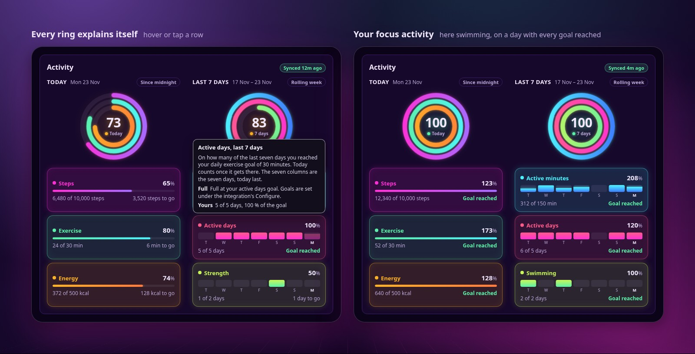
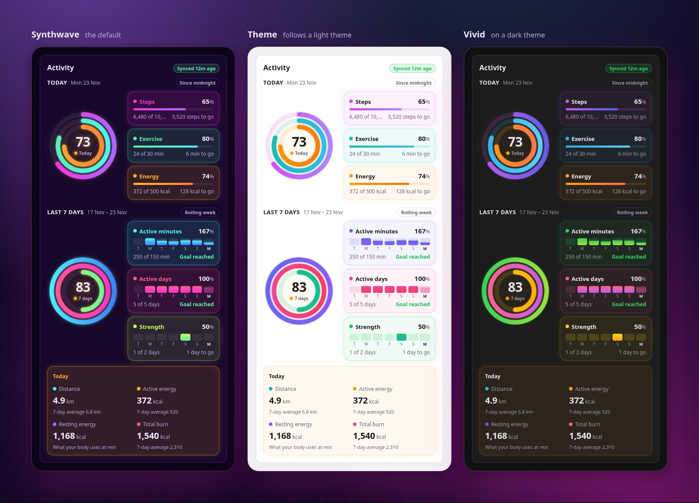

# ActiveRings

<p align="center">
  
</p>

<p align="center">
  <a href="https://github.com/MulletBoy/activerings/releases/latest"></a>
  <a href="https://github.com/MulletBoy/activerings/actions/workflows/test.yml"></a>
  <a href="https://github.com/MulletBoy/activerings/actions/workflows/validate.yml"></a>
  
  <a href="LICENSE"></a>
  <a href="https://ko-fi.com/mulletboy"></a>
</p>

<p align="center">
  <a href="#install">Install</a> ·
  <a href="#the-rings-family">The Rings family</a> ·
  <a href="#the-card">The card</a> ·
  <a href="#how-the-rings-fill">The rings</a> ·
  <a href="#entities">Entities</a> ·
  <a href="#privacy">Privacy</a>
</p>

Steps, exercise and workouts for Home Assistant, as rings you want to close. ActiveRings takes
the activity data your watch and phone already send to Home Assistant and fills six rings
against your own goals: three for today, three for the last seven days. A full ring is always
good news. It is part of the [Rings family](#the-rings-family), alongside
[SleepRings](https://github.com/MulletBoy/sleeprings) and
[VitalRings](https://github.com/MulletBoy/vitalrings).

ActiveRings is one install: a custom integration that works out the figures, and a card that the
integration loads into your dashboards by itself.

ActiveRings is free and stays free. If it earns a place on your dashboard, you can
[buy me a coffee on Ko-fi](https://ko-fi.com/mulletboy). ☕

<p align="center">
  
</p>

Three looks, and every colour can be changed:

<p align="center">
  
</p>

<sub>The screenshots show invented sample data, not anyone's activity.</sub>

## The Rings family

ActiveRings is one of a family of Home Assistant apps that turn the health data from your watch
into rings you want to close. They share one look, install the same way and sit side by side on
a dashboard. Each works on its own; together they cover your night and your day.

| | App | What it scores |
|---|---|---|
|  | **[SleepRings](https://github.com/MulletBoy/sleeprings)** | Your night: an Apple-Watch-style sleep score from duration, bedtime and interruptions, with sleep stages, sleeping heart rate and a 30-night history. |
|  | **[VitalRings](https://github.com/MulletBoy/vitalrings)** | Your body: heart, recovery and breathing, sleeping heart rate, blood oxygen and VO2 max, with heart rate, VO2 max and weight charts. |
|  | **ActiveRings** (you are here) | Your movement: steps, exercise and active energy today, and active minutes, active days and your focus activity over the last seven days, with steps and exercise charts and your workouts. |

More may follow.

## What it shows

- **Two sets of rings**, each ring filled against a goal you set, so a full
  ring is always good news:
  - **Today** (since midnight): Steps, Exercise and Energy.
  - **Last 7 days** (a rolling week, today included): Active minutes, Active
    days and your **focus activity**. Each of these rows shows the seven days
    as seven small columns, today last, so you can see which days counted.
- **A focus activity you choose**: the kind of workout you want to keep up.
  Strength training unless you pick another (running, walking, hiking,
  cycling, swimming, rowing, yoga, pilates, high-intensity training, dancing),
  or type the name of any other kind.
- **Today's figures**: distance, active energy, resting energy and total burn,
  each beside its 7-day average.
- **Steps chart**: every day of the last 30 days, or the average a day in each
  week or month back to your first step, with your goal as a line. With it:
  your 7-day average, your run of days on goal, and your best day of the last
  year.
- **Exercise chart**: minutes in each week, with your weekly goal as a line.
- **Workouts**: your recent workouts with length, distance, pace, energy and
  heart rate.

## What you need

- Home Assistant 2026.11 or newer, with the recorder (it is on by default).
- [Life Dashboard](https://github.com/owen282000/life-dashboard-ha) 1.4.0 or
  newer with its iOS companion app, which sends Apple Health data to Home
  Assistant. **1.5.0 or newer is recommended:** it keeps your past workouts,
  so they are there from before you installed ActiveRings. It is the only
  supported source so far; others can be added through a small adapter, see
  [Adding a source](#adding-a-source).
- The stock Home Assistant companion app is not enough: it reports a step
  count when it happens to sync, with no daily history and no workouts.

## Install

[](https://my.home-assistant.io/redirect/hacs_repository/?owner=MulletBoy&repository=activerings&category=integration)

1. Open **Settings > Marketplace**, choose **Add from link** and paste
   `https://github.com/MulletBoy/activerings` (type: Integration). On Home Assistant versions before
   2026.11 with HACS: **HACS > Custom repositories**.
2. Download **ActiveRings** and restart Home Assistant.
3. Go to **Settings > Devices & services > Add integration > ActiveRings**.
4. Choose whose activity data to use (your Life Dashboard entry).
5. Add the **Active Rings** card to a dashboard and pick any ActiveRings entity.
6. Optional: set your goals and your focus activity under **Configure** on the integration.

Manual install: copy `custom_components/active_rings` into your `config/custom_components`
folder and restart.

## What's new

| Version | In short |
|---|---|
| **1.1.0** | Past workouts now come from Life Dashboard itself where it keeps them (Life Dashboard 1.5.0 and newer): after a "Send history" from the phone app, the workouts from before you installed ActiveRings are there too, and a workout deleted or corrected later is followed. ActiveRings' own log stays as the fallback for older Life Dashboard versions. |
| **1.0.0** | First release: six rings filled against your own goals in two sets (Today and Last 7 days) with an explanation on every ring, a focus activity you choose, today's distance and energy, the steps and exercise charts, a workout log, nine sensors, and the card in three presets. |

Full notes for every version are on the [releases page](https://github.com/MulletBoy/activerings/releases).

## How the rings fill

A ring shows how far you are towards its goal and is full at 100 %. The row beside it shows the
real share, which can pass 100 %. The number in the middle of a set is the mean of its three
rings, each counted to 100 at most.

| Set | Ring | Counts | Default goal |
|---|---|---|---|
| Today | Steps | Steps since midnight | 10,000 |
| Today | Exercise | Exercise minutes since midnight | 30 minutes |
| Today | Energy | Active energy since midnight | 500 kcal |
| Last 7 days | Active minutes | Exercise minutes over the last seven days, today included | 150 minutes |
| Last 7 days | Active days | Days of the last seven that reached your daily exercise goal | 5 days |
| Last 7 days | Focus activity | Days of the last seven with a workout of your focus activity | 2 days |

All six goals and the focus activity are set under **Settings > Devices & services >
ActiveRings > Configure**. The defaults lean on the World Health Organization's guidelines for
adults: at least 150 minutes of moderate activity a week, and muscle strengthening on two or
more days a week (which is why the focus activity starts as strength training with a goal of
two days).

"Last 7 days" is a rolling week: today and the six days before it. It does not start again on
Monday, so the rings never empty overnight at the start of a week.

Hover a ring's row in the card (or tap it, or move to it with the keyboard) for what it counts,
what fills it, and your own figure.

### The focus activity

The focus activity is the kind of workout you want to keep up. Each name in the list stands for
every kind of workout that belongs to it: Cycling counts a ride outdoors and one on a
stationary bike, Swimming counts the pool and open water, Strength training counts weights,
functional strength, core and bodyweight training. If your sport is not in the list, type its
name as your health app names it (for example `tennis` or `rock_climbing`) and workouts of that
kind are counted.

## Entities

One device per person, with:

| Sensor | What it is |
|---|---|
| Today score | Mean of the Steps, Exercise and Energy rings (0 to 100). Attribute: how many rings it is made of |
| Week score | Mean of the Active minutes, Active days and focus activity rings (0 to 100). Attribute: how many rings it is made of |
| Steps 7-day average | Average steps a day over the last seven complete days. Attributes: 30-day average, the days it is made of, goal |
| Exercise last 7 days | Exercise minutes over the last seven days, today included. Attributes: goal, share of the goal |
| Active days last 7 days | Days that reached the daily exercise goal. Attributes: goal, share of the goal, the minutes that make a day active |
| Focus activity days last 7 days | Days with a workout of the focus activity. Attributes: the activity, goal, share of the goal |
| Workouts last 7 days | How many workouts were recorded. Attribute: their minutes |
| Steps goal streak | Days in a row on the steps goal. Attributes: the longest run of the last year, goal |
| Resting energy today | Total energy less active energy |

Today's steps, distance, energy and exercise minutes are already sensors of your health
integration, so ActiveRings does not repeat them.

## The card

`custom:active-rings-card`, added to every dashboard automatically (no resource
to register). Point it at any entity of the ActiveRings device:

```yaml
type: custom:active-rings-card
entity: sensor.activity_today_score
```

| Option | Default | |
|---|---|---|
| `entity` | | Any entity of an ActiveRings device (required) |
| `name` | `Activity` | Title |
| `preset` | `synthwave` | `synthwave`, `theme` (follows your light or dark theme) or `vivid` |
| `show_rows` | `true` | A row beside the rings for each ring: share of the goal, the figure and what is left |
| `show_today` | `true` | Today's distance, active energy, resting energy and total burn |
| `show_steps` | `true` | Steps chart, 7-day average, goal streak and best day |
| `show_exercise` | `true` | Exercise chart |
| `show_workouts` | `true` | Recent workouts |
| `workouts_shown` | `5` | How many workouts the list shows: `1` to `12` |
| `steps_range` | `30d` | Period the steps chart opens on: `30d`, `6m`, `1y`, `all` |
| `exercise_range` | `6m` | Period the exercise chart opens on: `3m`, `6m`, `1y` |
| `distance_unit` | unit system | `km` or `mi` |
| `energy_unit` | `kcal` | `kcal` or `kJ` |
| `tiles` | preset | Tinted boxes around each part |
| `theme_background` | `false` | Keep the theme's card background with the Synthwave preset |
| `colors` | | Override any colour, for example `steps: "#ff2fd6"` |

The card is one column wide by default and rearranges itself at two and three
dashboard columns.

## How the figures are worked out

- **Today's totals** come from your health integration's "today" sensors. Right
  after midnight those still hold yesterday's totals until the next sync, so
  ActiveRings checks which day a total is for and starts the new day at zero.
- **Averages** use complete days only, and only days that have a total: a day
  your phone was off is left out, not counted as zero.
- **Active days** are the days whose exercise minutes reached your daily
  exercise goal. Today counts once it gets there.
- **The goal streak** counts the days in a row that reached your steps goal.
  Today joins the run once it reaches the goal, and does not break it before
  then.
- **Workouts** come from Life Dashboard's own list of past workouts where it
  keeps one (1.5.0 and newer): ActiveRings asks for it and its log follows it,
  so a workout you delete or correct on your phone is deleted or corrected
  here, and after a "Send history" from the phone app your older workouts are
  there too. With an older Life Dashboard, which keeps workouts for two days
  only, ActiveRings' log is what remembers them: it then starts on the day
  you install ActiveRings, so in its first week the focus activity ring counts
  fewer than seven days, and the card says since when it is counting.
- Values that cannot be right (a day of 900,000 steps, a workout that lasts a
  week) are ignored.

## Privacy

- ActiveRings makes no network requests. It only reads data another integration
  already holds in your Home Assistant.
- It keeps one thing of its own: the log of your workouts (kind, times, length,
  distance, pace, energy, heart rate, steps), for up to 400 days, in a private
  file in Home Assistant's storage folder. Deleting the ActiveRings entry
  deletes the log. Like the rest of that folder, it is part of your Home
  Assistant backups. Every other figure is worked out again from the source's
  entities and long-term statistics.
- The sensors it creates are ordinary Home Assistant entities, so their history
  and statistics are recorded like any other sensor's (and stay in the
  recorder after the entry is deleted, until you purge them), and anyone who
  can log in to your Home Assistant can read them and the card. No sensor
  carries the list of your workouts: the sensors hold counts and totals only,
  and the name of your focus activity.
- Its diagnostics download contains no totals, goals, workouts, times or entity
  ids.
- The card is one JavaScript file served by Home Assistant itself; it loads
  nothing from elsewhere.

## Adding a source

Sources live in `custom_components/active_rings/sources/`. A source is a small class that says
where another integration keeps its activity data: which entities carry today's totals, which
long-term statistics hold the daily history, and how to read its workouts. See
`life_dashboard.py` and the `ActivitySource` protocol in `sources/__init__.py`. Everything after
that (rings, averages, the streak, the workout log, sensors, the card) is shared.

## Development

```bash
pip install -r requirements-test.txt   # Python 3.14.2 or newer
ruff check . && ruff format --check . && pytest

cd card
npm ci --ignore-scripts
npm run build                          # also copies the bundle into the integration
node demo/build-demo.mjs               # dist/demo.html: the card with invented sample data
```

The images in this README are taken from `dist/demo.html?showcase`. The goals and their limits
are in `custom_components/active_rings/const.py`, the focus activities in `workouts.py`.

## Support

ActiveRings is a hobby project and free to use. Bug reports and pull requests are the most useful
support. If you would like to say thanks another way, there is
[Ko-fi](https://ko-fi.com/mulletboy).

## Credits

- [Life Dashboard](https://github.com/owen282000/life-dashboard-ha) by Owen Vogelaar provides the
  activity data.
- The default goals follow the World Health Organization's *Guidelines on physical activity and
  sedentary behaviour* (2020).
- [ChromaFlow](https://github.com/Aresitoo/chromaflow) by AresLab inspired the look of the rings
  and rows.

## Licence

[MIT](LICENSE)
